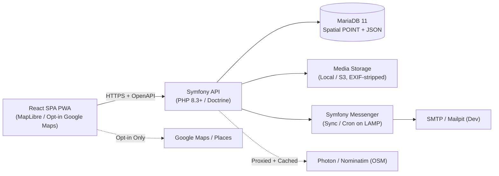
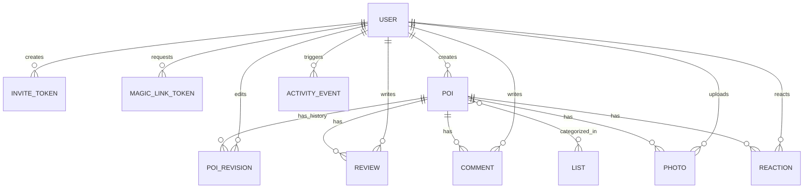

# Technical Design Document (TDD): `yummy`

**Status:** Approved  
**Related Specs:** [PRD.md](./PRD.md) | [openapi.yaml](./api/openapi.yaml) | [ADRs](./adr/)

---

## 1. System Architecture

`yummy` is a decoupled **React SPA PWA** communicating over HTTPS JSON with a **Symfony API** backed by **MariaDB 11**, designed to deploy on a standard LAMP host while providing full-featured local development via DevContainers.



### Key Architectural Boundaries
1. **Static Frontend + PHP Backend:** In production, Vite compiles the React PWA into static assets (`dist/`) served by Apache/Nginx alongside Symfony's `public/index.php`.
2. **Zero-Leakage Third-Party Isolation:**
   - Default map tiles load from OpenFreeMap (or self-hosted Protomaps `.pmtiles` served via HTTP Range requests from the same origin).
   - Geocoding queries go through Symfony (`GET /api/geocode`) so client IPs are never exposed to Photon/Nominatim, with responses cached in MariaDB.
   - Google Maps JS SDK is dynamically imported *only* when `GET /api/config` reports `googleMapsEnabled: true` **and** the user has accepted the privacy consent modal.
3. **LAMP-Compatible Async Tasks:** Symfony Messenger handles email dispatch and image thumbnailing; in LAMP production without a daemonized worker, emails/images can run synchronously or via a periodic `cron` job (`bin/console messenger:consume async --time-limit=50`).

---

## 2. Data Model (MariaDB 11)



### Core Tables & Columns

| Table | Key Columns | Notes |
| :--- | :--- | :--- |
| `users` | `id` (UUIDv7), `email` (unique), `display_name`, `roles` (JSON: `ROLE_ADMIN` / `ROLE_USER`), `created_at` | No password column. |
| `invite_tokens` | `id`, `token_hash` (SHA-256, unique), `created_by_id`, `claimed_by_id` (nullable), `expires_at`, `claimed_at`, `revoked_at` | Single-use; raw token shown once to creator. |
| `magic_link_tokens` | `id`, `user_id`, `token_hash` (SHA-256, unique), `expires_at` (15m), `used_at` | Single-use; invalidated on verification. |
| `lists` | `id`, `name`, `slug`, `color`, `icon`, `created_by_id`, `created_at` | Shared collaborative collections/tags. |
| `pois` | `id`, `name`, `description`, `address`, `location` (`POINT SRID 4326`, spatial index), `latitude`, `longitude`, `is_public` (bool, default `false`), `version` (int, optimistic lock), `created_by_id`, `created_at`, `updated_at` | Spatial index enables fast `MBRContains` bounding-box queries. |
| `poi_lists` | `poi_id`, `list_id` | Composite PK join table. |
| `poi_revisions` | `id`, `poi_id`, `revision_number`, `editor_id`, `changed_fields` (JSON diff + snapshot), `created_at` | Immutable audit log for wiki-style edits & reverts. |
| `reviews` | `id`, `poi_id`, `author_id`, `rating` (1–5), `body`, `is_public` (default `false`), `created_at`, `updated_at` | One or more reviews per user/POI (configurable; default 1 per user per POI). |
| `comments` | `id`, `poi_id`, `author_id`, `body`, `is_public` (default `false`), `created_at` | Lightweight discussion thread on a POI. |
| `photos` | `id`, `poi_id`, `uploader_id`, `storage_key`, `mime_type`, `width`, `height`, `caption`, `is_public` (default `false`), `created_at` | EXIF/GPS stripped via PHP `imagick`/`gd` on upload. |
| `reactions` | `id`, `poi_id`, `user_id`, `emoji`, `is_public` (default `false`), `created_at` | Unique constraint on `(poi_id, user_id, emoji)`. |
| `activity_events` | `id`, `actor_id`, `event_type`, `poi_id`, `target_type`, `target_id`, `payload` (JSON), `is_public` (denormalized), `created_at` | Indexed by `(created_at DESC)` for cursor-paginated feed. |
| `geocode_cache` | `query_hash` (SHA-256 PK), `provider`, `response_json`, `expires_at` | Caches Photon/Nominatim results in MariaDB (e.g., 7-day TTL). |

---

## 3. Security, Privacy & Visibility Enforcement

### 3.1 Session & Token Security
- Authentication uses Symfony stateful `HttpOnly; Secure; SameSite=Lax` session cookies (stored in MariaDB `sessions` table or filesystem, avoiding JWT revocation issues).
- Both `invite_tokens` and `magic_link_tokens` store only `hash('sha256', $rawToken)`.
- Rate limiting (Symfony RateLimiter) protects `/api/auth/magic-link` and `/api/auth/invites/{token}/claim` against brute-force and email-flooding.

### 3.2 Granular Visibility Model
Every query for POIs, reviews, comments, photos, reactions, and activity events passes through a centralized visibility filter:
- **Authenticated (`ROLE_USER` / `ROLE_ADMIN`):** Sees all items.
- **Unauthenticated (`Guest`):**
  - `POI` queries enforce `poi.is_public = true`.
  - Child item queries (`Review`, `Comment`, `Photo`, `Reaction`, `ActivityEvent`) enforce `item.is_public = true AND poi.is_public = true`.
- **Media Access Control:** Photos are **not** served directly from an unauthenticated `/uploads/` web directory. They are served via `GET /api/photos/{id}/file` (or signed/proxied `X-Sendfile` / `BinaryFileResponse`) so Symfony enforces the exact `poi.is_public && photo.is_public` check before streaming bytes.

### 3.3 Photo EXIF/GPS Stripping
- On upload (`POST /api/pois/{id}/photos`), Symfony validates MIME type (`image/jpeg`, `image/png`, `image/webp`) and max file size, strips all EXIF/IPTC/XMP metadata (including GPS coordinates and camera serials) via `imagick` (`stripImage()`) or `gd` re-encoding, generates a display-sized variant (max 2048px) and thumbnail (400px), and stores them under a random UUID key.

---

## 4. Bootstrap Configuration (`GET /api/config`)

The React SPA fetches `GET /api/config` on boot before initializing any map renderer:

```json
{
  "googleMapsEnabled": false,
  "defaultMapStyleUrl": "https://tiles.openfreemap.org/styles/liberty",
  "pmtilesUrl": null,
  "geocoderProvider": "photon",
  "publicBrowsingEnabled": true
}
```

- If `googleMapsEnabled` is `false`, the Google Maps toggle and Places Autocomplete UI are completely omitted.
- If `pmtilesUrl` is set (e.g., `/tiles/region.pmtiles`), MapLibre initializes the `pmtiles` protocol handler for 100% self-hosted tiles.
